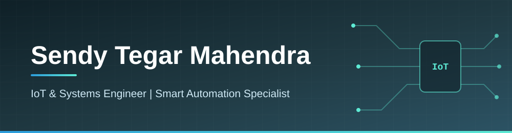

<!-- ========== BANNER (file lokal: assets/banner.svg) ========== -->

  

<!-- ========== TYPING ANIMATION ========== -->

  

<!-- ========== KONTAK ========== -->

  
  
  

---

## About Me

I'm a final-year Computer Engineering student passionate about building end-to-end technological solutions. I bridge physical infrastructure with data intelligence, specializing in IoT architectures, machine learning, and integrated smart systems.

- 🎓 **Education:** Computer Engineering at Universitas Muhammadiyah Karanganyar (Graduating 2026)
- 💡 **Focus:** Internet of Things (ESP32/Arduino), Embedded C/C++, Network Infrastructure (LAN), and Data-Driven Automation
- 🏆 **Achievement:** Holder of Intellectual Property Rights (HKI) for an Automated Waste Classification System
- 🔭 **Currently working on:** Smart automation systems integrating ESP32, Firebase, and Flutter
- 📫 **Open to opportunities:** IoT Engineer · Embedded Systems Engineer · Automation Engineer

🌐 Bahasa Indonesia

 

Saya mahasiswa tingkat akhir Teknik Komputer yang berfokus membangun solusi teknologi menyeluruh, dari perangkat keras hingga aplikasi dan data. Bidang saya mencakup arsitektur IoT, machine learning, dan sistem otomasi cerdas.

---

## Tech Stack & Tools

<!-- 
Klik logo untuk membuka situs resmi / dokumentasinya
 -->

<b>🔌 Embedded &amp; IoT</b>

  
  
  

<b>📱 Web, Mobile &amp; Cloud</b>

  
  
  
  
  

<b>📊 Data Analytics &amp; AI</b>

  
  
  
  
  
  
  <!-- 

 -->

---

## Featured Projects

<table>
  <tr>
    <th width="33%" align="left">Precision Automatic Feeding System</th>
    <th width="33%" align="left">Smart Classroom Architecture</th>
    <th width="33%" align="left">Automated Waste Classification</th>
  </tr>
  <tr valign="top">
    <td>IoT-based chopped grass feeding system with a Double Stage Conveyor, ESP32, and Firebase RBAC.</td>
    <td>Centralized IoT system with hierarchical priority control (Admin &gt; Auto &gt; Manual).</td>
    <td>Arduino-based smart bin prototype with C/C++ sequential logic to autonomously sort hazardous waste.</td>
  </tr>
  <tr valign="top">
    <td><b>Result:</b> 94.6% dosing accuracy</td>
    <td><b>Result:</b> 26.2% reduction in operational electrical waste</td>
    <td><b>Result:</b> HKI Certified</td>
  </tr>
  <tr valign="top">
    <td>
      
      
      
    </td>
    <td>
      
      
    </td>
    <td>
      
      
    </td>
  </tr>
</table>

<i>📌 More projects, source code, and documentation are in the pinned repositories below.</i>

---

## GitHub Analytics

  

<!-- Aktifkan kembali kartu statistik di bawah ini ketika angka aktivitas sudah bertambah
     (hapus tanda komentar pembuka dan penutup):

  

-->

---

  <i>Let's build something smart together. </i>

